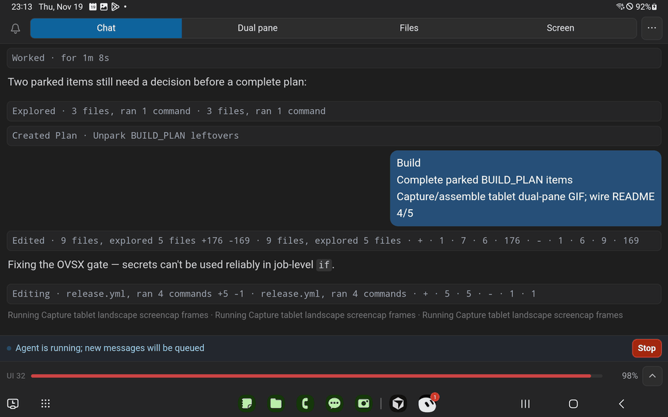
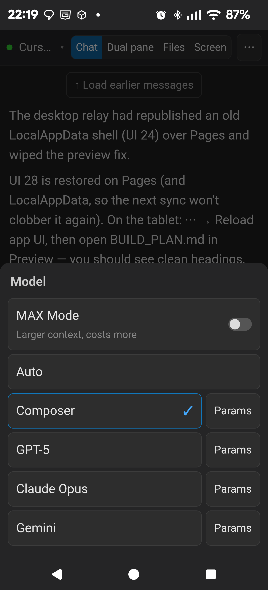
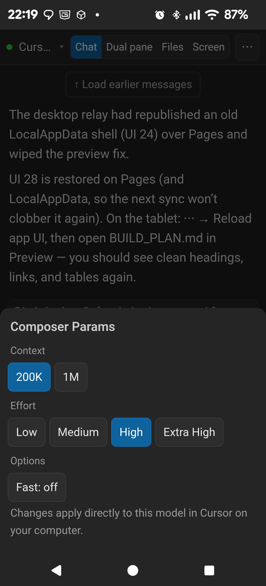
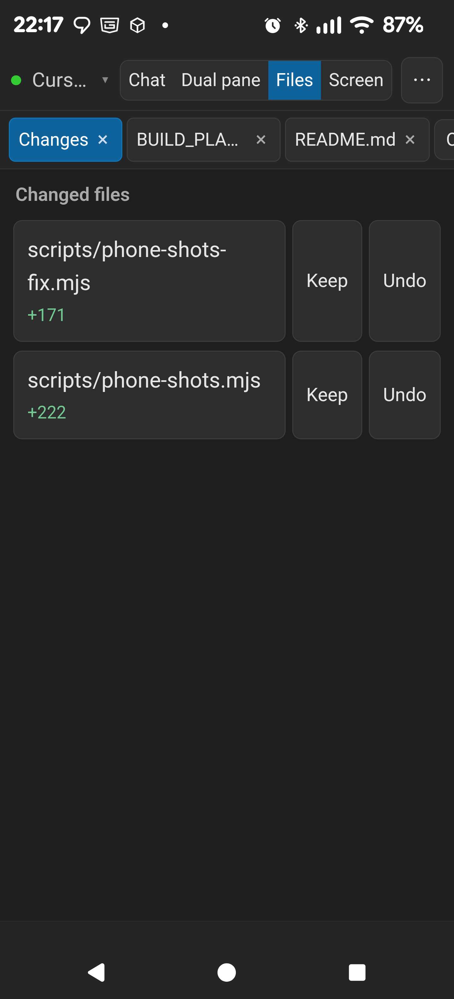
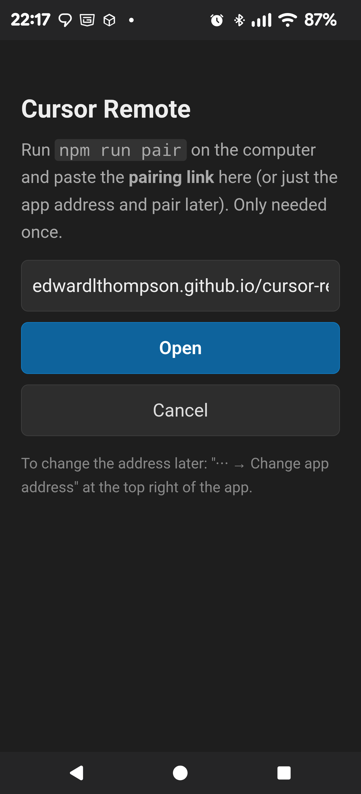

**English** | [中文](README.zh.md)

<p align="center">
  
</p>

# Cursor Remote Lite

### Your Cursor Agent. In your pocket. Still on *your* machine.

Walk away from the desk. The laptop stays home — plugged in, Cursor still running. On the train, in a meeting, or from the couch, your **phone or tablet** is the remote: ship prompts, get shouted when a turn finishes, answer the Agent’s questions, tap Run / Allow, review diffs, Keep or Undo files. Local windows. SSH remotes. Agents. Same sessions you’d drive at the keyboard.

**Free. MIT. Self-hosted.** No license key. No cloud Agent relay. Native **Android APK** (works without Google services), **iPhone** via Add to Home Screen, Windows tray EXE/MSI, Linux packages, optional Telegram + Cursor extension.

> Fork of [Suchenl/cursor-remote-lite](https://github.com/Suchenl/cursor-remote-lite) (inspired by [len5ky/CursorRemote](https://github.com/len5ky/CursorRemote)). This fork stays free and ships the **tablet dual-pane workspace**, **editor sync**, **OpenShouter-ready finish alerts**, tray packaging, clipboard bridge, and multi-device lock.

<p align="center"></p>

<p align="center"><sub>Phone demo: preview a file → switch windows → raise reasoning → approve a run → queue while busy → Keep / Undo changes.</sub></p>

## The pitch in one screen

<p align="center"></p>

<p align="center"><sub><b>Tablet landscape</b> — <b>Chat | Dual pane | Files | Screen</b>. Dual pane puts the Agent chat beside live Cursor editors (tabs, Open…, Markdown Preview / Source). Compact <b>Stop</b> on the running banner. Composer collapses so the columns act as a live monitor; usage stays on a bottom dock. Finish alerts hit the shade (and OpenShouter) when the prompt completes. Still: <a href="docs/en/ui-tablet-landscape.png">PNG</a>.</sub></p>

## Screenshots

| Chat | File preview | Switch window | Pick model |
|:-:|:-:|:-:|:-:|
|  |  |  |  |
| **Model parameters** | **Running: subagents + queue** | **Changed files** | **Confirm risky actions** |
|  |  |  |  |

## Why I built this

### A typical day

Before leaving in the morning, you ask Cursor's Agent to fix a bug in a project that lives on your company's GPU server (an SSH remote window). Then you commute, sit in meetings, grab lunch, or travel for two days, and the laptop stays behind.

Meanwhile the Agent finishes a turn and waits for you to check it; stops to wait for you to tap "Run"; or asks you a question like "When a session expires, should we return 401 or renew it?". You also think of the next thing you want it to do.

**What you need isn't "a quick remote peek". It's being able to keep working without your computer**: give tasks, answer questions, approve commands, see which files changed, and decide what to keep or undo. And the work has to happen in your own environment: your local code and data, your configured SSH servers, your installed dependencies.

### What existing options can do, and where they fall short

- **Cursor's official mobile app** (Cursor for iOS + Remote Control): iPhone / iPad only (iOS 26+), with no native Android app yet; requires a paid plan; Remote Control only works with the Agents window, and the Agent's reasoning loop moves to Cursor's cloud. Conversations already running in regular editor windows or SSH remote windows can't be controlled.
- **[len5ky/CursorRemote](https://github.com/len5ky/CursorRemote)**: same idea (controls the local Cursor through its debugging port), but requires a $7.99/month license, and the code is source-available rather than open source; for access from outside your network you have to set up Tailscale or a Telegram bot yourself.
- **Remote desktop** (Sunlogin, ToDesk, RustDesk, Chrome Remote Desktop): can control everything, but it means driving a shrunken desktop on your phone; reading Cursor's chat panel, hitting tiny buttons and typing are all painful, it uses a lot of data, and nothing tells you when the Agent finishes or needs you.

### What this project does

A tiny relay on your PC drives the **real** Cursor there. Your phone/tablet gets a purpose-built UI — not a shrunk desktop:

- **Chat like a messenger** — bubbles, tools, thinking; queue messages while the Agent runs; one compact **Stop** on the running banner.
- **Get interrupted only when it matters** — heads-up **Finished** / **Needs OK** with sound; Continue / Reply / Approve / Skip / Stop from the shade. Built for apps like **OpenShouter** (timestamped alerts, not a silent ongoing listen).
- **Work the editors remotely** — **Chat | Dual pane | Files | Screen**; Dual pane syncs Cursor tabs both ways; Open… + Markdown Preview for `BUILD_PLAN.md` and friends.
- **Ship the review** — unified **git diffs**, Keep / Undo; clipboard push/pull; attach photos into the composer; drafts saved per window.
- **See your budget** — Cursor **usage %** dock always visible at the bottom (composer expands on demand).
- **Every window** — local, SSH remote, Agents; mode / model / reasoning anytime.
- **Stay in control on two devices** — phone + tablet **control lock** (Take control); optional Telegram + Cursor extension.
- **Your bits stay home** — Cloudflare tunnel, LAN, or localhost. Android without Google services; iPhone via Home Screen. Mainland China–friendly paths.

### Why support both Android and iPhone

The official app is iPhone-only, but people's phones are far from all iPhones:

| Region | iOS | Android | Period |
|---|---|---|---|
| United States | 60.7% | 39.3% | August 2026 |
| Europe | 39.5% | 60.4% | July 2026 |
| Worldwide | ~28% | ~72% | 2026 |
| Mainland China | Minority | Majority, and many Huawei, Xiaomi, OPPO, etc. phones have no Google services | — |

Data from [StatCounter](https://gs.statcounter.com/os-market-share/mobile/), which measures each OS's share of traffic across roughly 1.5 million websites. It reflects "phones actually in use", not sales. iPhone users browse more, so iOS's share is slightly inflated; treat the exact numbers as rough, but the conclusion is clear: **iPhone is slightly ahead in the US, Android leads in Europe and worldwide, and in China most phones are Android without Google services**.

So this project provides both: an Android app that installs without Google services, and a full-screen "Add to Home Screen" app on iPhone (no App Store listing needed, so it works in Europe too).

## How it compares

### Vs the Suchenl upstream we forked

| | **This fork** (`edwardlthompson/cursor-remote-lite`) | **Suchenl/cursor-remote-lite** |
|---|---|---|
| Windows host | **System-tray EXE/MSI**, Start with Windows, keep-awake, ADB pair | Manual Node / scripts |
| Linux packages | **deb + tar.gz** on Releases | Manual |
| Dual pane | **Chat \| Dual pane \| Files \| Screen** — draggable split, **editor tabs synced** with Cursor, Markdown Preview | Phone-first layout |
| Diffs | Unified **git diff** + Keep/Undo | Changed-file list / preview |
| Clipboard | Phone ↔ Cursor **push/pull** | — |
| Multi-device | **Control lock** + Take control | Shared session |
| Android alerts | Heads-up **Finished / Needs OK** + sound; OpenShouter-friendly timestamps; DND-safe channels; in-app APK update | SSE / basic |
| Usage | Live **Usage %** bar from Cursor | — |
| Agent ops | **BUILD_PLAN**, slash commands, gap list (bootstrap child) | README |

Full matrix: [`docs/GAP_LIST.md`](docs/GAP_LIST.md). Slash commands: type `/` → see [`docs/help/BATCH_COMMANDS.md`](docs/help/BATCH_COMMANDS.md).

### Vs other options

| | **This fork (Cursor Remote Lite)** | Cursor official iOS app | len5ky/CursorRemote | Remote desktop |
|---|---|---|---|---|
| Price | **Free forever** | Paid Cursor plan | $7.99/month | Free / paid |
| License | **MIT open source** | Closed | Source-available | — |
| Android | **Native APK** (no Google services) | ❌ | Browser / Telegram | Vendor app |
| iPhone | Add to Home Screen (PWA) | Native (iOS 26+) | Browser / Telegram | Vendor app |
| Windows it controls | **All**: local, SSH, Agents | Agents only (Remote Control) | Mostly local | Whole desktop |
| Where code / chats live | **Only on your PC** (tunnel to your phone) | Agent loop often in Cursor cloud | Your PC + LAN / Tailscale | Vendor servers |
| Away-from-home access | Built-in Cloudflare tunnel + fixed Pages address | Built in | DIY Tailscale / Telegram | Built in |
| Phone UX | Chat + **Dual pane editors** + Files + Screen + diffs + clipboard | Native Agents UI | Chat UI | Tiny desktop |
| Done / waiting alerts | **Android heads-up + sound** (shade / OpenShouter); Web Push; Telegram | ✅ | Telegram | ❌ |
| Multi-device (phone + tablet) | **Control lock** per window | — | — | Shared desktop |
| PC packaging | **Win tray EXE/MSI**, Linux deb, macOS service, Cursor VSIX | — | — | — |
| Telegram | Optional, free, forum topics / window | — | Optional | — |
| Computer must stay awake | Yes | Cloud Agents: no; Remote Control: yes | Yes | Yes |

**Limitations** (stated up front):

- Relies on Cursor’s UI via CDP — a major Cursor redesign may need a relay update.
- macOS still has the nicest launchd install; Windows uses the **system-tray EXE** (Start with Windows) instead of a classic service.
- Cloudflare free quick tunnels can briefly disconnect and reconnect.

## Features

### Core remote control
- **Chat mode**: Agent conversations as a chat app (bubbles, tool cards, thinking); approval buttons when Cursor waits.
- **File preview**: tap a blue file name or 📄 tool card (SSH via passwordless `ssh` from your PC).
- **Screen mode**: live view of the chat panel or whole window; tap, scroll, zoom, keys.
- **Multiple windows**: local / SSH / Agents from the title control.
- **Modes / models / history**: Agent / Plan / Ask, model picker, parameters (context, reasoning, Fast, MAX), History, New chat.
- **Agent questions**: questionnaire cards with Skip / Submit; notifications include the question.
- **Queue & sub-agents**: queue while busy; list/stop sub-agents; stop the main Agent (compact **Stop** on the running banner).
- **Changed files**: line add/del, Keep / Undo (confirm on Undo), Keep All / Undo All when Cursor offers them.
- **Images**: attach a photo/screenshot into Cursor’s composer.
- **Voice input** (opt-in): Android recognizer or browser speech API.
- **English / 中文**: UI + notification language under **⋯ → 语言 / Language**.

### Why this fork feels like a product
- **Dual pane workspace**: **Chat | Dual pane | Files | Screen** on landscape (any width). Draggable split; **editor tabs sync** with Cursor both ways; Open… (open editors + workspace typeahead); **Markdown Preview / Source** for `.md`.
- **Finish alerts that actually shout**: Android heads-up **Finished** / **Needs OK** with sound and actions; timestamped posts for **OpenShouter**; DND-safe channels; delivery over WebSocket + SSE replay so a flaky tunnel doesn’t swallow “done”.
- **Usage dock**: live Cursor included-usage % pinned at the bottom; History / New / message box expand from the chevron (collapsed by default in landscape).
- **Composer drafts**: typed text persists per Cursor window across Chat / Dual / Files switches (cleared on Send).
- **Diff review + clipboard**: unified git diff sheet; paste phone → Cursor; pull selection / last code block → phone.
- **Multi-device lock**: phone + tablet won’t double-Approve; **Take control** (90s idle TTL).
- **Stay connected**: Android foreground keepalive + UI heartbeat; **⋯ → Reload app UI** when a stale shell sticks.
- **Windows tray**: `CursorRemote.exe` / MSI — Start with Windows, keep-awake, ADB pair, Quit.
- **Telegram** (optional) + **Cursor / VS Code extension** — [docs/TELEGRAM.md](docs/TELEGRAM.md), [docs/EXTENSION.md](docs/EXTENSION.md).
- **Agent ops board**: `BUILD_PLAN.md`, slash recipes (`/tour` `/coach` `/verify` `/ship`), gap list — bootstrap child of agent-project-bootstrap.

### Trust & access
- **Device pairing**: one-time QR / deep link; optional TOTP 2FA; hashed tokens only on the PC.
- **Fixed address**: your own GitHub Pages app + encrypted `url.json` — tunnel URL can change without re-pairing.
- **ADB auto-pair**: EXE/deb can install the APK and open the pairing deep link when a device is connected.

## How it works

```
Phone app (GitHub Pages) ──HTTPS/WebSocket──> Cloudflare tunnel ──> relay on your computer (Node) ──CDP──> Cursor
```

(Phone app on GitHub Pages → Cloudflare tunnel → relay (Node) on your computer → Cursor.)

Cursor is built on Electron. When started with `--remote-debugging-port`, the relay uses the Chrome DevTools Protocol to read chat content, capture the screen, and simulate clicks and keyboard input.

## Requirements

- **PC**: Windows, Linux, or macOS with **Node.js 22+**
- **Away-from-home**: [cloudflared](https://developers.cloudflare.com/cloudflare-one/connections/connect-networks/downloads/) (bundled in Win/Linux packages)
- **Fixed phone URL**: [GitHub CLI](https://cli.github.com/) (`gh`) logged in, for Pages setup
- **Easiest path**: download the prebuilt **Windows EXE/MSI**, **Linux .deb**, and **Android APK** from [Releases](https://github.com/edwardlthompson/cursor-remote-lite/releases/latest) instead of running from source

## Quick start (5 minutes)

**Step 1: Install on your computer**

```bash
git clone https://github.com/edwardlthompson/cursor-remote-lite.git
cd cursor-remote-lite
npm install
npm run setup        # create the phone app repo, enable start at login, optionally enable 2FA
./start-cursor.sh    # restart Cursor with the debugging port (quits the current Cursor first)
```

**Windows (automated):** from an external PowerShell window (not Cursor's terminal):

```powershell
npm install
powershell -ExecutionPolicy Bypass -File .\setup-windows.ps1
# or non-interactive setup only: npm run setup:auto
powershell -ExecutionPolicy Bypass -File .\start-cursor.ps1
npm run public
```

`npm run setup` / `setup:auto` creates a public repository under **your own** GitHub account (named `cursor-remote-app` by default) and uses GitHub Pages to host the phone app and your computer's encrypted address. Everyone uses their own; it has nothing to do with the author or other users.

**Step 2: Pair your phone**

```bash
npm run pair
```

A QR code appears in the terminal (valid for 10 minutes, single use). Scan it with your phone's camera or browser to open it; there's no password to type.
If you can't scan it, send the link shown below the QR code to your phone and open it (or paste it into the app's input box).

<p align="center"></p>

**Step 3: Packages (recommended instead of babysitting a terminal)**

| Platform | Download |
|---|---|
| **Windows** | [CursorRemote.exe](https://github.com/edwardlthompson/cursor-remote-lite/releases/latest/download/CursorRemote.exe) / [CursorRemote.msi](https://github.com/edwardlthompson/cursor-remote-lite/releases/latest/download/CursorRemote.msi) — **system tray**, Start with Windows, keep-awake, ADB auto-pair |
| **Linux** | [CursorRemote-linux-x64.deb](https://github.com/edwardlthompson/cursor-remote-lite/releases/latest/download/CursorRemote-linux-x64.deb) or [tar.gz](https://github.com/edwardlthompson/cursor-remote-lite/releases/latest/download/CursorRemote-1.8.3-linux-x64.tar.gz) → `cursor-remote` |
| **Android** | [CursorRemote.apk](https://github.com/edwardlthompson/cursor-remote-lite/releases/latest/download/CursorRemote.apk) — no Google services required (Huawei OK). HarmonyOS NEXT needs Zhuoyitong before APKs. |
| **iPhone** | Open the Pages URL in Safari → Share → **Add to Home Screen** |
| **Cursor extension** | [cursor-remote-lite.vsix](https://github.com/edwardlthompson/cursor-remote-lite/releases/latest/download/cursor-remote-lite.vsix) |
| **Telegram** (optional) | `TELEGRAM_BOT_TOKEN` + `/start`; forum `/sync` for per-window topics — [docs/TELEGRAM.md](docs/TELEGRAM.md) |

If an Android phone is on USB/Wi‑Fi ADB and the APK sits next to the EXE/deb, first run can **install + open pairing** automatically.

**Step 4: Start using it**

- The top-left shows the current window; tap it to switch windows (local / SSH / Agents).
- Send messages from the input box at the bottom; use `Agent ▾` / `Auto ▾` to switch mode and model; "History" opens earlier conversations and "＋ New" starts a new one.
- When the Agent is waiting for your approval (running a command, accepting changes), the buttons show up right in the conversation.
- Tap a blue file name or a card marked 📄 to preview a file; press Back to close it.
- "Screen" in the top-right switches to the live view, where you can tap anything in the Cursor UI.
- "⋯ → Enable notifications" in the top-right makes your phone alert you when the Agent finishes or needs approval (see "Notifications" below).

From now on, Cursor must always be started with the debugging port; just launch it with `./start-cursor.sh`.

## Notifications

**Goal:** when the Agent finishes a turn (or waits for Run/Allow), your phone **shouts** — heads-up banner + sound, same energy as Cursor’s desktop chime. Works with the shade and shout apps like **OpenShouter**.

### Turn it on (Android app)

1. Open **Cursor Remote** → **⋯ → Turn on notifications** (allow the system permission if asked).
2. Tap **⋯ → Send a test notification**. You should get a heads-up banner **and** a sound.
3. Leave the quiet “Cursor Remote is listening…” ongoing notification in the shade (keeps the process alive — it is *not* the shout).
4. **Samsung / Xiaomi / Huawei / OPPO:** unrestricted battery / Auto-run / App launch → allow.
5. In **Settings → Apps → Cursor Remote → Notifications**, confirm **Agent finished** and **Agent needs your OK** are High / Alerting with sound (not Silent). If OEMs locked an old channel silent, use **⋯ → Fix silent notifications**.

We use the **system notification sound** (Cursor’s proprietary desktop chime isn’t redistributable).

### When alerts fire

| Event | What you get |
|---|---|
| **Finished** | Timestamped heads-up + sound when a prompt completes. Fires even if that window is open on the phone. Delivered over the live WebSocket (and SSE), so a stale tunnel URL doesn’t silence you. |
| **Waiting** | Heads-up + sound after ~10s on Run / Allow / Accept. Suppressed only for the window you’re actively viewing. |

| Phone | How notifications arrive | Things to note |
|---|---|---|
| Android app | Persistent SSE connection to your computer (no Google services required) | Keep background unrestricted; test with “Send a test notification” |
| iPhone | System push (Web Push) | Add to Home Screen; open from the icon; iOS 16.4+ |
| Desktop / Android browser | Browser push | Allow notifications in the browser |

Notifications are sent by your computer: the Android app connects straight to it; iPhone/browsers go through Apple/Google push, with end-to-end encrypted payloads.

## Keeping your computer online (preventing sleep)

The relay runs on your computer, so **once your computer sleeps, your phone can't connect**.

| | Screen locked | Display off | Sleep / lid closed |
|---|---|---|---|
| Does the phone still work? | ✅ Yes | ✅ Yes (screen mode falls back to periodic screenshots, a bit choppy) | ❌ No |

So there's only one thing to do: **allow the display to turn off and the screen to lock, but don't let the system sleep**.

### macOS

**Laptops (no sleep while plugged in)**: System Settings → Battery → Options → turn on "Prevent automatic sleeping on power adapter when the display is off".
Or use the command line (affects only the plugged-in state; `-c` = charger):

```bash
sudo pmset -c sleep 0          # never sleep while plugged in
sudo pmset -c displaysleep 10  # display still turns off after 10 minutes (saves power, doesn't affect use)
pmset -g | grep -E " sleep|displaysleep"   # show current settings
```

**Desktops (Mac mini / iMac / Studio)**: System Settings → Energy → turn on "Prevent automatic sleeping when the display is off".

**Just stay awake temporarily** (e.g. letting the Agent run a long task before you head out):

```bash
caffeinate -s    # prevent sleep while plugged in; press Ctrl+C to restore
```

**Closing the lid**: a MacBook always sleeps when the lid is closed (unless it has an external display + power + keyboard). If you want to use it remotely, don't close the lid; turn the brightness all the way down and lock the screen instead.
Forcing it with `sudo pmset -a disablesleep 1` is not recommended: it will overheat if you put it in a bag.

### Windows

Settings → System → Power & battery → Screen and sleep: set "When plugged in, put my device to sleep after" to **Never**; you can keep "Turn off my screen" (e.g. 10 minutes).
Or use an administrator PowerShell:

```powershell
powercfg /change standby-timeout-ac 0     # never sleep while plugged in
powercfg /change monitor-timeout-ac 10    # turn off the display after 10 minutes
powercfg /change hibernate-timeout-ac 0   # never hibernate while plugged in
# Don't sleep when the laptop lid is closed (while plugged in):
powercfg /setacvalueindex SCHEME_CURRENT SUB_BUTTONS LIDACTION 0
powercfg /setactive SCHEME_CURRENT
```

**Preferred (no console):** install **CursorRemote.exe** / MSI — WinForms tray (`WinExe`), `CreateNoWindow` + `win-run.mjs --hidden`, Start with Windows. Pair with `npm run pair` or tray → Pair over ADB. First extract may flash a brief console, then frees it so only the tray icon remains.

**From source** (PowerShell outside Cursor’s terminal, which dies when Cursor restarts):

1. `powershell -ExecutionPolicy Bypass -File .\start-cursor.ps1` — restarts Cursor with the debug port.
2. Console-free host: `npm run win:hidden` (same as tray: quiet stdout, `windowsHide` on child processes). Foreground debug: `npm run public` / `npm run win` (these **keep** a console on purpose).

### Trade-offs

- **Power use**: a laptop idling with the display off draws about 3–8 W, under 0.2 kWh per day; a desktop draws 30–100 W, 1–2 kWh per day.
- **Battery**: keeping a laptop plugged in at full charge for long periods speeds up battery wear. macOS's "Optimized Battery Charging" and Windows vendors' "battery protection / 80% charge limit" help; turning them on is recommended.
- **Security**: a computer that's always on can always be controlled by paired phones. Keep it locked (locking doesn't affect use), and remove devices you no longer use under "⋯ → Paired devices".

### What happens if you don't set this up

- After your computer sleeps, the phone shows "Computer offline" and you can't do anything; **any task the Agent is running also pauses** until someone wakes the computer.
- After waking, the service recovers automatically. The tunnel address changes, but the new address is published automatically and the phone reconnects within about a minute, **no re-pairing needed**.

## Security

- **Pairing**: the link generated by `npm run pair` contains a random key and a one-time pairing code; it expires after 10 minutes and is invalidated after use. After pairing, the phone receives a device token, and the computer stores only its hash.
- **Nothing on GitHub to crack**: `url.json` (your computer's address) in the Pages repository is encrypted with a random 256-bit key. That key is passed to the phone only through the pairing link and is never uploaded. There's no password, so there's no offline password brute-forcing either.
- **Two-factor verification (optional)**: `npm run 2fa` binds Google Authenticator / Microsoft Authenticator / 1Password, etc. Once enabled, pairing a new device requires a 6-digit code; you can also require re-verification every N days (default 30; 0 means only verify at pairing). Even if a pairing link leaks, it can't be used without the code from your phone.
- **Managing devices**: view and remove devices on your phone under "⋯ → Paired devices", or on your computer with `npm run devices`. A removed device is disconnected immediately.
- Debugging port 9222 listens only on localhost; in public mode the relay also listens only on `127.0.0.1`, so it can only be reached from outside through the tunnel.
- Repeated failed pairing attempts trigger a temporary lockout.
- A paired device has full control over your Cursor, which is equivalent to being able to run commands on your computer. **Don't post pairing links in group chats or anywhere public.**

## Common commands

| Command | What it does |
|---|---|
| `npm run setup` | Setup wizard (can be re-run) |
| `npm run pair` | Pair a new device (shows a QR code) |
| `npm run devices` | List paired devices; `npm run devices remove <id>` removes one |
| `npm run 2fa` | Enable / re-bind Authenticator 2FA; `npm run 2fa off` disables it; `npm run 2fa status` shows status |
| `npm run public` | Run in the foreground (public access + fixed address; console stays open) |
| `npm run win:hidden` | Windows host without a console (dev equivalent of the tray EXE) |
| `npm run sync-ui` | Push `app/` to GitHub Pages, wait for CDN, reload phone/tablet (WS + ADB) |
| `npm start` | Run in the foreground (LAN only) |
| `./service.sh status / logs / uninstall` | Background service status / logs / uninstall |
| `npm run reset` | Clear all pairings, 2FA and configuration (you'll need to pair again afterwards) |

## FAQ

**The phone shows "Not connected to Cursor"**: Cursor wasn't started with the debugging port; run `./start-cursor.sh` (on Windows, `start-cursor.ps1`).

**The phone shows "Computer offline"**: the computer is asleep / shut down, or the service just restarted (the new address takes effect in about a minute, and the app retries automatically). See "Preventing sleep" above.

**Got a new phone / cleared browser data**: run `npm run pair` on your computer to pair again, and delete the old device under "Paired devices".

**Does it cost anything? Does it use up any free quotas?** No. At runtime it uses only three things:
- Cloudflare quick tunnels: free, no sign-up required.
- GitHub Pages: free for public repositories. Your computer publishes its address once per restart (one commit); Pages recommends no more than 10 builds per hour, and going over just means changes take effect a bit later.
- GitHub API: 5,000 requests per hour; only a handful are actually used.

GitHub Actions is only used when this fork publishes a new release; nothing runs on your account for day-to-day use.

**Not receiving notifications**: first use **⋯ → Send a test notification**. If the test never arrives: Android notification permission + unrestricted battery; try **⋯ → Fix silent notifications**. If the test works but Agent-finished doesn’t: keep the quiet “listening” FGS, don’t let the PC sleep, and start Cursor with `./start-cursor.sh` / `start-cursor.ps1`. OpenShouter only shouts timestamped alerts — not the ongoing listen notification.

**Doesn't work on a company network**: Cloudflare tunnels use port 443, which usually works; if even `trycloudflare.com` is blocked, you can only use `npm start` on the same LAN.

**SSH remote window doesn't show up**: tap the window name in the top-left to open the window list; the list refreshes every time you open it.

**Tapping a file says it can't be found**: the file may have been deleted or moved; for files in SSH windows, your computer needs passwordless `ssh` to that machine.

## License

MIT. Copyright notice for the original upstream author is retained in [LICENSE](LICENSE). This fork is maintained at [edwardlthompson/cursor-remote-lite](https://github.com/edwardlthompson/cursor-remote-lite).
