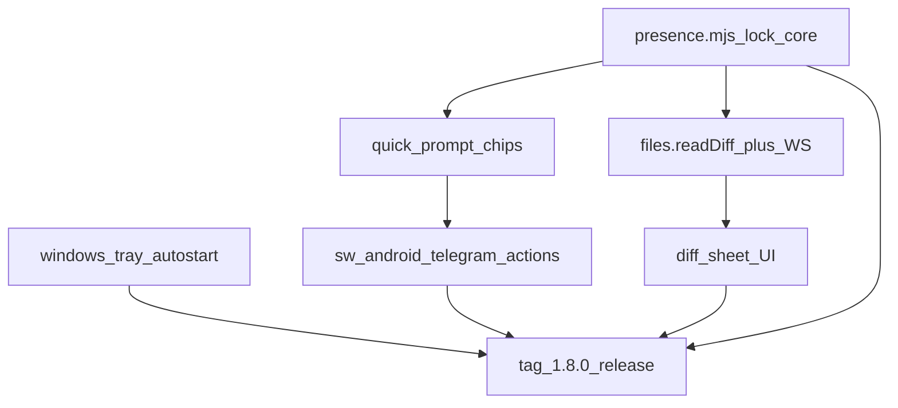

# Roadmap 1.8 — Away Faster

Chosen theme from the post-1.7.0 brainstorm: **speed + multi-device reliability** while the laptop stays behind.

Out of scope for 1.8 (parked): auto-approve policies, deferred prompts, clipboard bridge, git/PR strip, iOS TestFlight, Wear OS, guest links, OVSX CI.

## Scope (four features)

1. Quick-prompt chips + notification Continue / Reply actions  
2. Diff review sheet for changed files  
3. Multi-device active-viewer lock (phone vs tablet)  
4. Windows tray / autostart so the PC relay stays up  

Version bump target: `1.8.0` in `package.json`, Android `versionName`/`versionCode`, extension package version, `CHANGELOG.md`.

---

## 1. Quick prompts + notification Continue / Reply

### UX

- Above the composer in [`app/index.html`](../app/index.html): horizontal chip row (scrollable). Defaults: `Continue`, `Fix tests`, `Summarize diff`, `Ship it` (editable).
- Long-press a chip → edit / delete; trailing `+` → add (max 12). Stored per device in `localStorage` (`quickPrompts` JSON).
- Tap chip → insert into composer (do not auto-send unless chip flag `submit: true`; default Continue submits).
- Notifications (Web Push + Android + Telegram) for `kind: 'done'` gain **Continue** and **Reply**.
  - Continue → headless send of the Continue quick-prompt (or literal `"Continue"`).
  - Reply → open app focused on that window with composer focused (Telegram: prompt user to reply in-thread; Web Push action opens app with `#win=&reply=1`).
- Waiting alerts keep Approve / Skip / Stop; add optional **Mute 30m** later if time allows (not required to ship).

### Implementation

| Area | Change |
|------|--------|
| [`app/index.html`](../app/index.html) | Chip UI above `#input` / send row; load/save prompts; `data-qp` click → `send({ t: 'send', text, submit })` or fill input |
| [`app/i18n.js`](../app/i18n.js) | Strings for chip editor, Continue, Reply |
| [`app/sw.js`](../app/sw.js) | `actions` on `showNotification` for `done` / `waiting`; `notificationclick` handles `action` → `postMessage` or `openWindow` with query |
| [`android/.../NotifyService.java`](../android/app/src/main/java/com/cursorremote/lite/NotifyService.java) | `addAction` PendingIntents for Continue / Reply; broadcast or deep link into WebView |
| [`notify.mjs`](../notify.mjs) | Include `actions: ['continue','reply']` in deliver payload for `done` |
| [`telegram.mjs`](../telegram.mjs) | For `done`, inline keyboard Continue / Reply; callbacks `cont:<winId>`, `reply:<winId>` → `headless.sendPrompt` or ask for next message |
| [`headless.mjs`](../headless.mjs) | Ensure `sendPrompt(winId, text)` is exported and used by Telegram Continue |

### Ship criteria

- [ ] Chip tap sends Continue without opening the soft keyboard.  
- [ ] Custom chips persist across app reload.  
- [ ] Telegram Done message Continue sends into the correct window/topic.  
- [ ] Web Push Continue / Reply actions work on installed PWA (Chromium); iOS may open app only (document limitation).  
- [ ] Fixture/unit: Telegram callback routing for `cont:` / `reply:` in `test/extract-fixtures.test.mjs` (string match) or new `test/telegram-actions.test.mjs`.

---

## 2. Diff review sheet

### UX

- Current sheet lists name + Keep / Undo ([`app/index.html`](../app/index.html) `openSheet('changes', …)`).  
- Tap file name (or new **Diff** control) opens a second sheet / full-screen viewer: unified diff, monospace, `+`/`-` coloring, swipe prev/next file, sticky Keep / Undo at bottom.  
- Cap: first ~200 KB of diff text; show “truncated” if larger. Binary → “Binary / image; open preview instead”.

### Implementation

| Area | Change |
|------|--------|
| [`files.mjs`](../files.mjs) | Add `readDiff(host, path)` — prefer `git diff --no-color -- HEAD -- path` in workspace root (local `spawn` / remote `ssh`); fallback: if no git, return `{ error: 'no-git' }` |
| [`server.mjs`](../server.mjs) | WS handler `t: 'diff'` → resolve path via existing workspace helpers + `filesState` row path → `readDiff`; emit `{ t: 'diff', name, text, truncated }` |
| [`app/index.html`](../app/index.html) | Diff sheet UI; wire `data-chopen` to request diff before/alongside file preview; Keep/Undo reuse `t: 'change'` |
| CDP extract | Prefer absolute path already collected in `changedFiles()` (`server.mjs` helpers ~385–406); if only basename, resolve via `workspaceForTitle` + search (existing file open path) |

### Ship criteria

- [ ] After Agent edits a tracked file, Diff sheet shows a readable unified diff.  
- [ ] Keep / Undo from diff sheet still works and refreshes the list.  
- [ ] Untracked/new file: show full content as “added” or clear empty-diff message.  
- [ ] SSH remote window: diff via same SSH path as `readFile`.  
- [ ] Test: unit-test `readDiff` against a temp git repo fixture (new `test/diff.test.mjs`).

---

## 3. Multi-device active-viewer lock

### UX

- When device A is foreground-attached to window W, device B still receives alerts but **control** actions on W show “OP13 is controlling this window” (device name) unless B takes over.  
- Banner on B: **Take control** → steals lock; A gets status toast “Control moved to SM-T875”.  
- Viewing (read chat / screen frames) stays allowed on all devices; only mutating WS messages require the lock: `send`, `click`, `change`, `queue`, `question`, `pickMenu`, `stop`, `mode`, etc.  
- Lock idle TTL: 90s after last `visible:true` / mutating action; auto-release so a backgrounded phone does not brick the tablet.

### Implementation

| Area | Change |
|------|--------|
| [`auth.mjs`](../auth.mjs) / state | Persist optional `locks.json` or in-memory map on relay: `{ [winId]: { deviceId, name, at } }` (in-memory is enough; survive restart by empty locks) |
| [`server.mjs`](../server.mjs) Session | On `attach` / `visible`, update presence; before mutating handlers, `assertControl(deviceId, winId)` |
| WS protocol | Emit `{ t: 'presence', win, holder, holderName, self: bool }`; accept `{ t: 'claim', win }` |
| [`notify.mjs`](../notify.mjs) | Existing `watching(deviceId, win)` already skips alerts for the device viewing that window — extend so non-holders still get waiting alerts (default), holders suppress; optional quiet flag later |
| [`app/index.html`](../app/index.html) | Presence banner + Take control; disable send/approve UI when `!self` |
| [`/api/status`](../server.mjs) | Include `locks` / connected device names for Setup panel |

### Ship criteria

- [ ] Two paired devices: A sends prompts; B cannot send until Take control.  
- [ ] After A backgrounds >90s, B can claim without prompt conflict.  
- [ ] Claiming notifies the previous holder over their open WS.  
- [ ] No cross-window lock bleed (lock is per Cursor window id).  
- [ ] Test: pure unit test of lock map claim/release/TTL logic extracted to `presence.mjs`.

---

## 4. Windows tray + autostart

### UX

- After MSI/EXE install, first run offers “Start with Windows” (default on).  
- Relay runs with a tray icon (Cursor Remote): Open status, Show QR / pair, Pause sleep-inhibit, Quit.  
- Closing the console window does not kill the relay when started in tray mode.  
- Document in README Windows section; remove “babysit the terminal” limitation for tray users.

### Implementation

| Area | Change |
|------|--------|
| New [`packaging/windows/tray.mjs`](../packaging/windows/tray.mjs) or small Electron/Systray helper | Prefer lightweight: `node-windows` / tray via existing stack — if adding native deps is heavy, ship a PowerShell + WinForms NotifyIcon companion `CursorRemoteTray.exe` built in [`packaging/windows/build.ps1`](../packaging/windows/build.ps1) that spawns `win-run.mjs` hidden and owns the tray |
| [`win-run.mjs`](../win-run.mjs) | Support `--hidden` / `CURSOR_REMOTE_TRAY=1`: no blocking console focus; write pid to `~/.cursor-remote-lite/relay.pid` |
| Autostart | HKCU `Run` value or Startup folder shortcut created by MSI custom action / first-run prompt; uninstall removes it |
| Sleep | Reuse README `powercfg` request: tray menu “Keep awake while relay runs” toggles a REQUEST `SetThreadExecutionState` from the tray process |
| [`docs/ARCHITECTURE.md`](ARCHITECTURE.md) | Note tray process next to `win-run.mjs` |
| Extension | Optional: Setup panel “Install tray autostart” button calling a script — nice-to-have, not required |

### Ship criteria

- [ ] Fresh MSI install → reboot → relay reachable on `:3939` without user login terminal.  
- [ ] Tray Quit stops relay cleanly; Start menu launches tray again.  
- [ ] Autostart can be disabled from tray and does not reappear until re-enabled.  
- [ ] Existing ADB auto-pair path still works when launched from tray.  
- [ ] Manual test checklist attached to release notes for Windows.

---

## Sequencing

1. Extract `presence.mjs` + wire lock in `server.mjs` (unblocks multi-device testing you already do).  
2. Quick prompts in app + Continue/Reply on Telegram/push.  
3. `readDiff` + diff sheet.  
4. Windows tray/autostart last (packaging-heavy; parallelizable once API stable).  
5. Bump to 1.8.0, CHANGELOG, GitHub release (EXE/MSI/APK/VSIX).

## Docs / tracking

- This file is the implementation contract for 1.8.  
- Update [`CHANGELOG.md`](../CHANGELOG.md) under `## 1.8.0` when shipping.  
- Keep brainstorm backlog ideas not listed here for 1.9+.

## Explicit non-goals for 1.8

- Monetization, license keys, cloud agent relay.  
- Scoped auto-approve command policies.  
- Full tablet landscape dashboard redesign (presence banner is enough).  
- Named Cloudflare / Tailscale preset UI.
